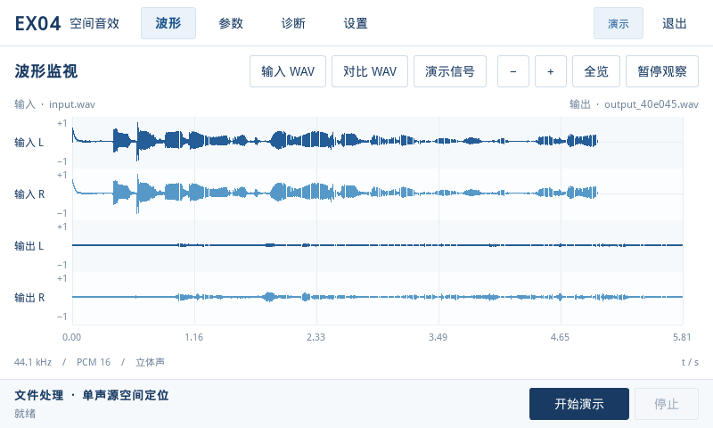
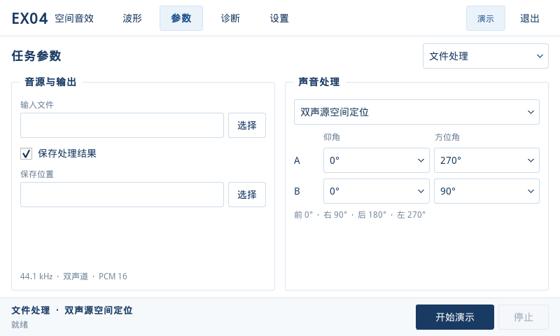

# Qt UI 验收证据（2026-11-01）

本目录记录 `frontend_arm` 蓝白界面重设计的桌面验证。截图由实际
`MainWindow`、Qt Widgets 和项目资源渲染产生，未使用网页或设计稿替代。

- 环境：WSL Ubuntu 22.04、GCC 11、Qt 5.15.3、offscreen、文泉驿微米黑。
- 最小界面：800×480；同时检查 1024×768。
- `core-tests.txt`：QtTest totals 为 15 通过、0 失败；含进程生命周期、具名参数、文件锁与真实 System V IPC。
- `ui-tests.txt`：QtTest totals 为 10 通过、0 失败；含方向、WAV、峰值包络、精确游标、过期请求、动态缓冲、演示和窗口交互。
- Qt4/ARM SDK、真实实时 PCM、ALSA/SysLink 与 HDMI 本轮未验证。

## 预览

| 截图 | 场景 |
|---|---|
| [800-wave-files.png](800-wave-files.png) | 真实输入 WAV 与处理结果四轨对比，保留输出尾部 |
| [800-dual.png](800-dual.png) | 双声源仰角、方位角及保存结果 |
| [800-record-parameters.png](800-record-parameters.png) | 录音参数 |
| [800-diagnostics.png](800-diagnostics.png) | 日志、smoke 和 IPC 验证入口 |
| [800-settings.png](800-settings.png) | 演示／板端环境与业务目录 |
| [800-board-empty.png](800-board-empty.png) | 板端无数据状态，未填充演示波形 |
| [800-validation.png](800-validation.png) | 参数错误定位 |
| [1024-wave.png](1024-wave.png) | 大尺寸窗口中的动态演示波形 |

更多构建与复现命令见 [frontend_arm/README.md](../../../frontend_arm/README.md)，
验证边界见 [frontend_arm/VALIDATION.md](../../../frontend_arm/VALIDATION.md)。
